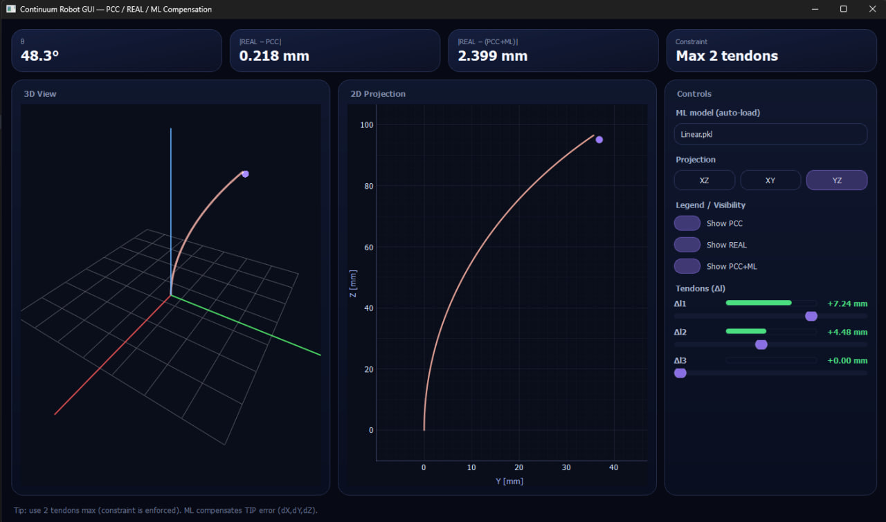
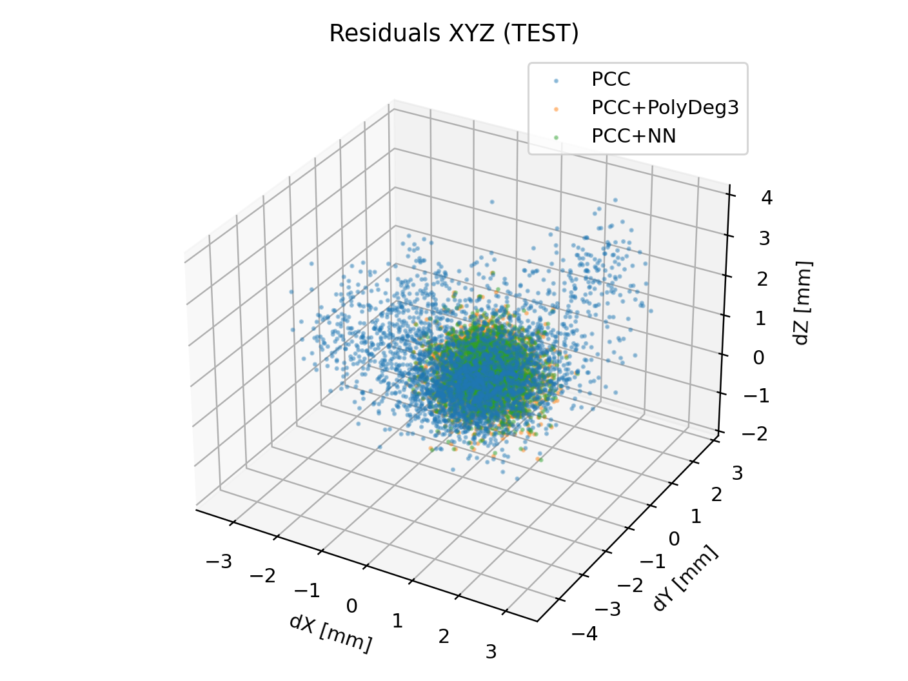
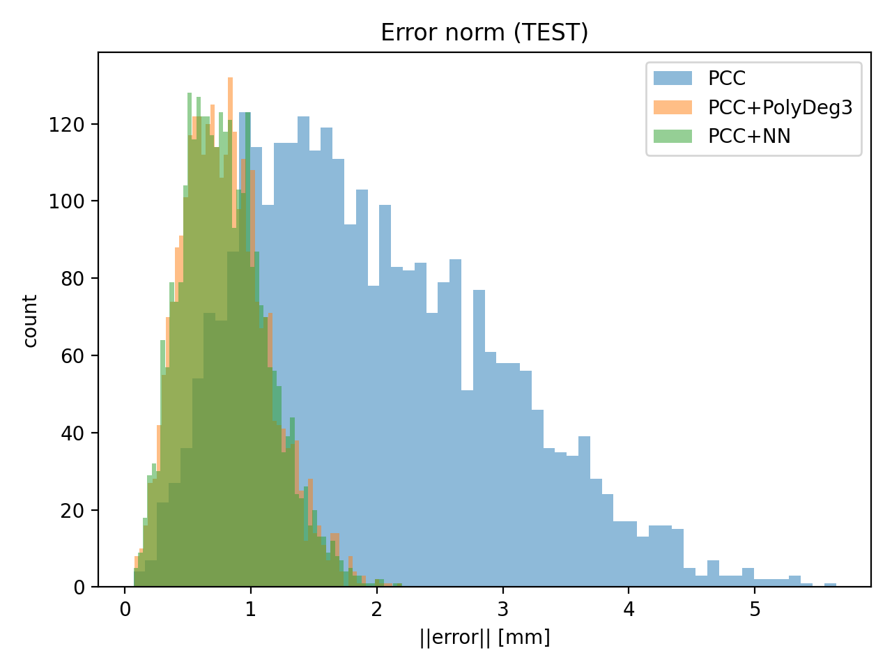
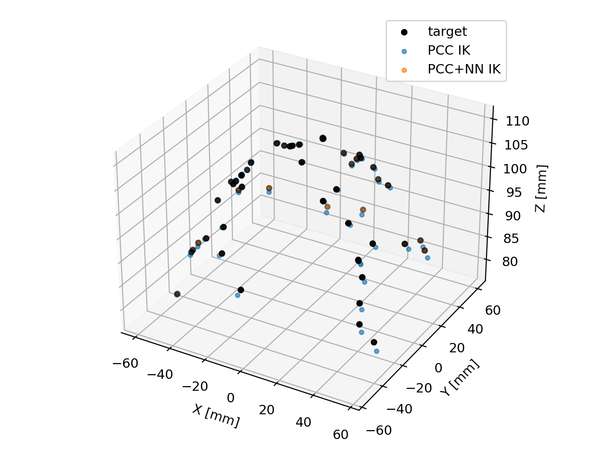
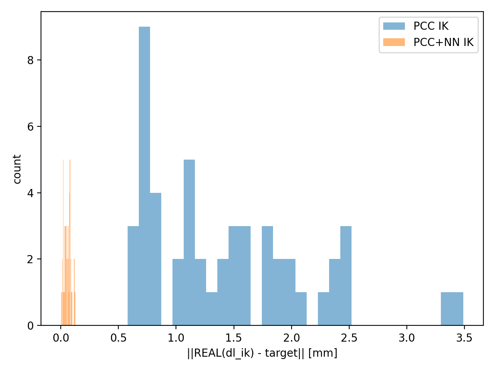
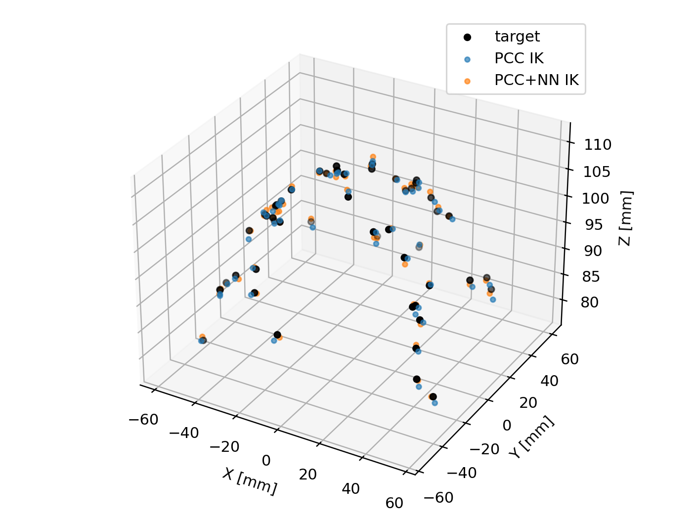
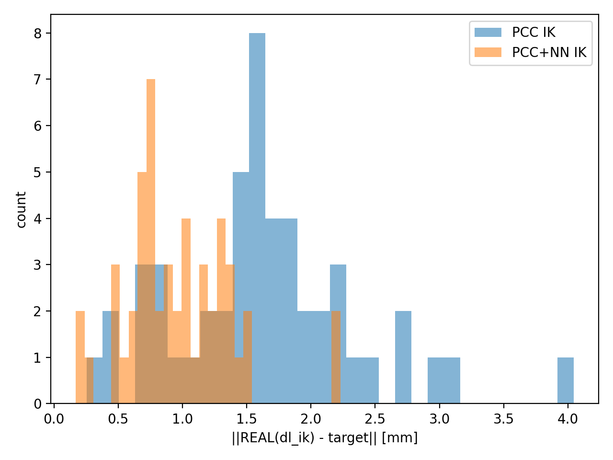

# Continuum robot kinematics error compensation

Diploma thesis: **Machine Learning-Based Error Compensation for Continuum Robot Kinematics** / **Kompenzácia chýb kinematiky kontinuum robota pomocou strojového učenia**.

This repository studies a one-segment, three-tendon continuum robot in simulation. The nominal backbone length is 110 mm, the PCC tendon-routing parameter is 5 mm, and tendon shortening is limited to 0-10 mm with at most two active tendons. Positions and errors are reported in millimetres.

## PCC model (Phase 1)

`src/continuum_robot/kinematics/pcc_model.py` implements the ideal piecewise constant-curvature (PCC) forward model. Tendon shortenings are actuator coordinates; bending-plane angle `phi`, curvature `kappa`, and bend angle `theta` are configuration coordinates; the end-effector position `(X,Y,Z)` is the task coordinate. `pcc_shape` returns the centreline for workspace/shape visualization, and `pcc_forward` returns its tip. The existing equations and coordinate assumptions are preserved.

## Synthetic reference model (Phase 2)

`src/continuum_robot/kinematics/synthetic_reference.py` is a **synthetic reference model**, also called a perturbed PCC model. It was previously named `real_model.py`; it is **not a model identified from a physical robot**. It adds controlled curvature nonlinearity, bending-plane asymmetry, bend saturation, a systematic position offset, and Gaussian measurement noise to create a reproducible simulation testbed while physical robot measurements are unavailable. Results in this repository establish synthetic feasibility; they do not demonstrate physical-robot accuracy.

### Dataset generation

`continuum_robot.data.generate_dataset` uses seed 42 to sample 20,000 valid tendon commands (at most two active), evaluates both forward models, and writes `dl1,dl2,dl3`, PCC XYZ, synthetic-reference XYZ, and `dX,dY,dZ = p_syn - p_PCC` to `data/final/dataset_3.csv`. `continuum_robot.data.csv_to_npz` converts the command/residual pairs to `data/final/dataset_3.npz` (`X` and `Y`). The CSV retains the full position columns.

## Phase 3 residual compensation and final evaluation

The PyTorch feedforward NN represents the **Cartesian residual**, not absolute XYZ: `f_NN(dl) ≈ p_syn(dl) - f_PCC(dl)`. The corrected forward position is `f_PCC(dl) + f_NN(dl)`. `continuum_robot.phase3.train_nn` uses a seeded train/validation/test split (70/15/15) and fits input/output scalers on the training split only. Its model, scalers, training metrics, and loss curve are in `artifacts/phase3_model/`.

`continuum_robot.phase3.evaluate` reproduces the historical Phase 3 comparison. `continuum_robot.phase3.evaluate_extended` adds Linear Regression, degree-3 Polynomial Ridge, KNN, and the **pretrained** canonical NN to a common held-out test comparison. Regressors and their scalers fit only on training rows; the NN is loaded without retraining. Errors compare PCC plus predicted residual with the synthetic-reference position. It also reports a large-bend test subset (`max(dl) >= 9 mm`, two active tendons).

## Phase 4 IK validation

`continuum_robot.phase4.inverse_kinematics` numerically solves tendon commands with either PCC or the corrected forward model under 0-10 mm and at most two active tendons. The synthetic reference model is used **only to generate targets and evaluate reached positions**, never inside the IK solver. IK error is `e_IK = f_syn(dl_IK) - p_target`, not the Phase 3 forward-model error at the original source command.

`continuum_robot.phase4.evaluate_extended` compares PCC IK and PCC+NN IK on at least 50 reachable targets. It includes random points and a deliberate large-bend subset with two active tendons, one shortened by 9-10 mm and the other by 7-10 mm. The deterministic run (`sigma=0`) measures systematic compensated-control accuracy. The optional noisy run (`sigma=0.5 mm`) tests robustness to Gaussian measurement noise; it uses separate noise draws for targets and final reached positions and pairs the same final noise draw across methods for each target.

## Repository structure

```text
.
|-- src/continuum_robot/     PCC, synthetic reference, Phase 2-4, experiments, plots, GUI
|-- data/
|   |-- final/              Canonical dataset CSV/NPZ, provenance, statistics
|   `-- legacy/             Earlier datasets
|-- artifacts/
|   |-- phase3_model/       Canonical NN and scalers
|   `-- legacy_models/      Earlier sklearn models and archived NNs
|-- results/
|   |-- final/              Final Phase 3, Phase 4, and summer reports
|   `-- legacy/             Earlier Phase 3/4 and Optuna outputs
|-- figures/
|   |-- methodology/        Synthetic compensation pipeline diagram
|   `-- legacy/             Earlier static illustrations
`-- legacy/source/          Historical scripts
```

The final executable modules are under `src/continuum_robot/`: `kinematics/` (PCC and synthetic reference), `data/` (dataset pipeline), `phase3/`, `phase4/`, `experiments/`, `visualization/`, `gui/`, and `common/` (shared metrics and paths). The GUI still uses legacy sklearn artifacts in `artifacts/legacy_models/`; Phase 3/4 use the PyTorch NN in `artifacts/phase3_model/`. Historical files are retained, not part of the main thesis outputs. Existing summary JSON files may mention their original paths as historical provenance; their contents were not rewritten during the move.

Canonical inputs: [dataset CSV](data/final/dataset_3.csv), [dataset NPZ](data/final/dataset_3.npz), [dataset provenance](data/final/dataset_3_provenance.json), [NN weights](artifacts/phase3_model/nn_model.pt), [input scaler](artifacts/phase3_model/x_scaler.pkl), and [output scaler](artifacts/phase3_model/y_scaler.pkl).

## Installation

```bash
python -m venv .venv
.venv\Scripts\activate
pip install -r requirements.txt
pip install -e . --no-deps
```

The editable install makes `python -m continuum_robot...` work from the repository root. `PySide6` and `pyqtgraph` are needed only for the GUI module. `Jinja2` supports the generated LaTeX tables. Run commands below from the repository root.

## Reproducibility commands

The existing canonical Phase 2/3 workflow is:

```bash
python -m continuum_robot.data.generate_dataset
python -m continuum_robot.data.csv_to_npz
python -m continuum_robot.phase3.train_nn
python -m continuum_robot.phase3.evaluate
```

The first three commands regenerate data or retrain the canonical model and can take time; they are **not needed** to use the existing artifacts for final validation. Run them only when intentionally rebuilding the lineage.

To create the thesis methodology figure and extended final reports:

```bash
python -m continuum_robot.visualization.pipeline_figure
python -m continuum_robot.phase3.evaluate_extended
python -m continuum_robot.phase4.evaluate_extended --real-noise-sigma 0 --out-dir results/final/phase4_ik_validation
python -m continuum_robot.phase4.evaluate_extended --real-noise-sigma 0.5 --out-dir results/final/phase4_ik_validation_noise05
python -m continuum_robot.experiments.summer_synthetic_experiments --quick
python -m continuum_robot.experiments.summer_synthetic_experiments --full
```

To restyle existing Phase 4 figures **without rerunning IK or changing CSV/JSON files**:

```bash
python -m continuum_robot.phase4.evaluate_extended --plots-only --out-dir results/final/phase4_ik_validation
python -m continuum_robot.phase4.evaluate_extended --plots-only --out-dir results/final/phase4_ik_validation_noise05
```

`--quick` is a short pilot with fitting-pool sizes 500, 1000, 2000 and all three architectures. `--full` covers all six requested sizes through 20,000 and trains longer. The results below are from a completed **full** run. These commands run experiments and write outputs; none runs automatically. The summer noise study only **evaluates** the canonical model at five noise levels; dataset-size, range, and architecture studies train separate experimental NNs and do not overwrite the canonical model.

## Phase 5: summer synthetic validation and additional experiments

Phase 5 is the summer work plan: final repository documentation and methodology diagram, final Phase 3/4 tables and figures, and additional synthetic experiments on dataset size, noise, range generalisation and network architecture. The existing final outputs below belong to this phase. Phase 6 is the subsequent evaluation using physical robot measurements.

`continuum_robot.experiments.summer_synthetic_experiments` produces four studies: (A) fitting-pool size, using an independent fixed test set; (B) Gaussian noise sigma 0, 0.2, 0.5, 0.8, and 1.0 mm, evaluating the unchanged canonical NN; (C) interpolation with training commands in 0-8 mm versus extrapolation to active tendon shortenings in (8,10] mm; and (D) 32-32, 128-64, and 256-128-64 hidden-layer architectures on the same split. Experimental NN inputs are the three shortenings plus activity indicators, and outputs are Cartesian residuals. Test sets are independent of training/validation sets; normalization is fit only on training data. The full run is intended for final thesis tables, while quick mode is a pilot. The script records the training or evaluation-only mode in `summary.json`.

Run the GUI with `python -m continuum_robot.gui.pcc_gui` after installing GUI dependencies.

## Existing Phase 4 workflow

Single-target smoke test:

```bash
python -m continuum_robot.phase4.inverse_kinematics --target 0 0 110
```

Main deterministic compensated-control benchmark:

```bash
python -m continuum_robot.phase4.inverse_kinematics --n-targets 50 --seed 42 --real-noise-sigma 0 --out-dir results/final/phase4_solver_noise0
```

Noisy robustness benchmark:

```bash
python -m continuum_robot.phase4.inverse_kinematics --n-targets 50 --seed 42 --real-noise-sigma 0.5 --out-dir results/final/phase4_solver_noise05
```

Each Phase 4 solver benchmark folder contains:

- `phase4_results.csv`
- `comparison_metrics.csv`
- `summary.json`
- `error_hist.png`
- `target_vs_reached_3d.png`
- `error_vs_target_index.png`
- `error_vs_dl_norm.png`

## Final synthetic validation outputs

The final generated reports are:

| Output | Contents |
|---|---|
| `figures/methodology/pipeline_synthetic_compensation.png` | Synthetic compensation methodology scheme |
| `results/final/phase3_forward_compensation/` | `phase3_metrics.csv/.tex`, boundary table, copied `loss_curve.png`, histogram, five-model boxplot, 3D position plot, per-axis plot, `summary.json` |
| `results/final/phase4_ik_validation/` | `phase4_ik_metrics.csv/.tex`, per-target results, PCC and PCC+NN 3D plots, histogram, boxplot, ordered target/reached axis plot, configuration plot, `summary.json` |
| `results/final/phase4_ik_validation_noise05/` | Robustness report with the same Phase 4 files |
| `results/final/summer_experiments/` | CSV/LaTeX tables and figures for dataset size, noise, range generalization, architecture, plus `summary.json` |

All tables below report Euclidean-norm errors in mm, displayed to six decimal places from the linked generated CSV files. The CSV files retain full precision and include per-axis metrics; `summary.json` files provide seeds, split or target counts, and method provenance.

### Phase 3 forward compensation

Held-out test set (`N=3000`): [full metrics CSV](results/final/phase3_forward_compensation/phase3_metrics.csv), [LaTeX table](results/final/phase3_forward_compensation/phase3_metrics.tex), [boundary metrics](results/final/phase3_forward_compensation/phase3_boundary_metrics.csv), [provenance](results/final/phase3_forward_compensation/summary.json).

| Method | MAE | RMSE | Median | P95 | Max |
|---|---:|---:|---:|---:|---:|
| PCC | 1.991968 | 2.226582 | 1.834655 | 3.810949 | 5.642002 |
| PCC + Linear Regression | 1.168793 | 1.284540 | 1.099738 | 2.152395 | 3.020670 |
| PCC + Polynomial Ridge | 0.799012 | 0.868309 | 0.770045 | 1.406348 | 2.196424 |
| PCC + KNN | 0.881152 | 0.954825 | 0.852146 | 1.533199 | 2.619147 |
| PCC + NN | 0.799555 | 0.868962 | 0.768868 | 1.416337 | 2.199613 |

Polynomial Ridge has a slightly lower RMSE than the NN on this noisy held-out set; the NN is not claimed as the best Phase 3 method by every metric. The Phase 4 comparison nevertheless uses the canonical pretrained NN as specified.

### Phase 4 inverse kinematics

Deterministic synthetic-reference benchmark (`sigma=0`, `N=50`): [full metrics CSV](results/final/phase4_ik_validation/phase4_ik_metrics.csv), [LaTeX table](results/final/phase4_ik_validation/phase4_ik_metrics.tex), [per-target results](results/final/phase4_ik_validation/phase4_ik_results.csv), [provenance](results/final/phase4_ik_validation/summary.json).

| Method | MAE | RMSE | Median | P95 | Max |
|---|---:|---:|---:|---:|---:|
| PCC IK | 1.821636 | 2.107236 | 1.588586 | 3.913806 | 4.332032 |
| PCC+NN IK | 0.049033 | 0.056883 | 0.044249 | 0.092010 | 0.127452 |

Noisy robustness benchmark (`sigma=0.5 mm`, `N=50`): [full metrics CSV](results/final/phase4_ik_validation_noise05/phase4_ik_metrics.csv), [LaTeX table](results/final/phase4_ik_validation_noise05/phase4_ik_metrics.tex), [per-target results](results/final/phase4_ik_validation_noise05/phase4_ik_results.csv), [provenance](results/final/phase4_ik_validation_noise05/summary.json).

| Method | MAE | RMSE | Median | P95 | Max |
|---|---:|---:|---:|---:|---:|
| PCC IK | 2.027120 | 2.297321 | 1.742344 | 4.031159 | 4.820420 |
| PCC+NN IK | 0.855486 | 0.961908 | 0.810726 | 1.679299 | 2.245389 |

These are reached-position errors after applying each IK solution to the synthetic reference model. They are not forward-model residuals at the original target-generating tendon command.

### Summer synthetic experiments

Dataset-size influence, full run (independent test set `N=2000`): [full metrics CSV](results/final/summer_experiments/dataset_size_metrics.csv), [LaTeX table](results/final/summer_experiments/dataset_size_metrics.tex).

| Training size | MAE | RMSE | Median | P95 | Max |
|---:|---:|---:|---:|---:|---:|
| 500 | 0.824620 | 0.892173 | 0.793764 | 1.441971 | 2.354731 |
| 1000 | 0.811606 | 0.878300 | 0.783915 | 1.432728 | 2.388352 |
| 2000 | 0.805804 | 0.872175 | 0.780262 | 1.411289 | 2.323646 |
| 5000 | 0.802938 | 0.869335 | 0.772476 | 1.406135 | 2.280766 |
| 10000 | 0.802264 | 0.868225 | 0.771130 | 1.398871 | 2.308417 |
| 20000 | 0.802398 | 0.868554 | 0.771046 | 1.398696 | 2.295354 |

Noise influence, canonical NN **evaluated only**, without retraining (`N=2000` at each sigma): [full metrics CSV](results/final/summer_experiments/noise_metrics.csv), [LaTeX table](results/final/summer_experiments/noise_metrics.tex).

| Noise sigma [mm] | MAE | RMSE | Median | P95 | Max |
|---:|---:|---:|---:|---:|---:|
| 0.0 | 0.062491 | 0.069372 | 0.056445 | 0.120454 | 0.245513 |
| 0.2 | 0.318873 | 0.346629 | 0.308127 | 0.567772 | 0.846630 |
| 0.5 | 0.784329 | 0.852337 | 0.755865 | 1.385394 | 2.180351 |
| 0.8 | 1.252718 | 1.361170 | 1.208753 | 2.212652 | 3.514583 |
| 1.0 | 1.565294 | 1.700745 | 1.509295 | 2.762952 | 4.404127 |

Range generalization, separately trained experimental NN (`N=1000` per range and method): [full metrics CSV](results/final/summer_experiments/generalization_metrics.csv), [LaTeX table](results/final/summer_experiments/generalization_metrics.tex).

| Test range [mm] | Method | MAE | RMSE | Median | P95 | Max |
|---|---|---:|---:|---:|---:|---:|
| Inside [0,8] | PCC | 1.348383 | 1.479953 | 1.251646 | 2.468678 | 3.242957 |
| Inside [0,8] | PCC+NN | 0.006520 | 0.007994 | 0.005408 | 0.014326 | 0.056474 |
| Outside (8,10] | PCC | 2.963311 | 3.034945 | 2.873074 | 4.318111 | 4.596224 |
| Outside (8,10] | PCC+NN | 0.221034 | 0.259360 | 0.206914 | 0.460891 | 0.577039 |

The experimental NN's error rises outside its 0-8 mm training range, although it remains below PCC error in this synthetic test. This does not establish extrapolation performance on a physical robot.

Architecture comparison, separately trained experimental NNs on the same test set (`N=2000`): [full metrics CSV](results/final/summer_experiments/architecture_metrics.csv), [LaTeX table](results/final/summer_experiments/architecture_metrics.tex), [provenance for all summer studies](results/final/summer_experiments/summary.json).

| Architecture | Hidden layers | MAE | RMSE | Median | P95 | Max |
|---|---|---:|---:|---:|---:|---:|
| Small | 32, 32 | 0.804880 | 0.871252 | 0.778165 | 1.399680 | 2.327911 |
| Medium | 128, 64 | 0.802938 | 0.869335 | 0.772476 | 1.406135 | 2.280766 |
| Large | 256, 128, 64 | 0.803858 | 0.870734 | 0.778169 | 1.397376 | 2.360755 |

### Final figures

- Methodology: [synthetic compensation pipeline](figures/methodology/pipeline_synthetic_compensation.png).
- Phase 3: [NN loss curve](results/final/phase3_forward_compensation/loss_curve.png), [PCC vs NN error histogram](results/final/phase3_forward_compensation/error_hist_pcc_vs_nn.png), [five-model error boxplot](results/final/phase3_forward_compensation/model_error_boxplot.png), [reference/PCC/NN 3D positions](results/final/phase3_forward_compensation/reference_pcc_nn_3d.png), [per-axis errors](results/final/phase3_forward_compensation/axis_errors.png).
- Phase 4 deterministic: [PCC IK target vs reached 3D](results/final/phase4_ik_validation/pcc_ik_target_vs_reached_3d.png), [PCC+NN IK target vs reached 3D](results/final/phase4_ik_validation/pcc_nn_ik_target_vs_reached_3d.png), [error histogram](results/final/phase4_ik_validation/ik_error_histogram.png), [error boxplot](results/final/phase4_ik_validation/ik_error_boxplot.png), [target vs reached trajectory](results/final/phase4_ik_validation/target_vs_reached_trajectory.png), [error vs configuration](results/final/phase4_ik_validation/error_vs_configuration.png).
- Phase 4 noisy: [PCC IK target vs reached 3D](results/final/phase4_ik_validation_noise05/pcc_ik_target_vs_reached_3d.png), [PCC+NN IK target vs reached 3D](results/final/phase4_ik_validation_noise05/pcc_nn_ik_target_vs_reached_3d.png), [error histogram](results/final/phase4_ik_validation_noise05/ik_error_histogram.png), [error boxplot](results/final/phase4_ik_validation_noise05/ik_error_boxplot.png), [target vs reached trajectory](results/final/phase4_ik_validation_noise05/target_vs_reached_trajectory.png), [error vs configuration](results/final/phase4_ik_validation_noise05/error_vs_configuration.png).
- Summer studies: [dataset-size RMSE](results/final/summer_experiments/dataset_size_rmse.png), [noise RMSE](results/final/summer_experiments/noise_rmse.png), [range-generalization boxplot](results/final/summer_experiments/generalization_boxplot.png), [architecture boxplot](results/final/summer_experiments/architecture_boxplot.png).

## Methodological notes

- In Phase 3, the NN predicts residual error `dX,dY,dZ = synthetic reference - PCC`, not absolute XYZ.
- In Phase 4, the corrected forward model is `f_corr(dl) = f_PCC(dl) + f_NN(dl)`.
- `synthetic_reference.py` is not used inside the IK solver.
- `synthetic_reference.py` is used only for target generation and final evaluation.
- The deterministic Phase 4 benchmark evaluates systematic compensated-control accuracy.
- The noisy Phase 4 benchmark checks robustness under Gaussian measurement noise.

## Phase 6: reviewed physical-data protocol (v2)

The reviewed protocol is implemented in `src/continuum_robot/phase5/review_v2.py`. **It has not been run on the physical dataset yet.** Its metric values must be taken only from `results/final/phase6_review_v2/` after the manual run below. The existing `phase5_real_compensation` results and numbers further down this page are an **archival v1 protocol**, not outcomes of v2. Earlier synthetic Phases 1–5 and the original physical measurements remain unchanged.

The v2 protocol reads the byte-preserved `data/real/Dataset-Actions-Positions.txt`, checks that processed XYZ values and row IDs exactly match it, and reuses the seven saved train/validation/test splits. It rejects a changed source or split instead of silently regenerating anything. Command values are divided by 10 to obtain tendon shortening in mm. XYZ is provisionally assumed to be in mm. Its origin, orientation, tracked marker and physical tendon numbering are not independently verified.

For **each split separately**, v2 fits candidate PCC registrations on training XYZ only: translation, proper rigid rotation plus translation, and reflected orthogonal rotation plus translation, each with six tendon permutations. It selects a candidate by validation RMSE. Scale is fixed at 1; geometry stays at the existing PCC values (110 mm backbone, 5 mm routing parameter). Tendon permutations can be geometrically equivalent under a free orthogonal mapping, so the selected order is an internal convention, not evidence of physical cable labels. The baseline is **train-registered PCC**, not a fully independent analytical calibration.

All residual models share the same registered PCC, train/validation/test IDs and train-fitted input/output scalers. V2 compares Linear, Polynomial Ridge degrees 2 and 3, distance-weighted KNN and FFNN (64/64 versus the previous 215/68 hidden layers). Ridge alpha, KNN neighbour count, NN architecture and NN checkpoint are selected on validation positions; NN early stopping uses validation RMSE in mm. The final test set is evaluated once. QA flags remain descriptive and never select v2 training rows or hyperparameters: the archived v1 `clean_train` sensitivity run used flags derived from the global neighbourhood, so it cannot support a strict leakage-free clean-training claim.

From the repository root in PowerShell, run the read-only input check first:

```powershell
.\.venv\Scripts\python.exe -m continuum_robot.phase5.review_v2 check
```

Then **manually** start the long physical-data experiments when ready:

```powershell
.\.venv\Scripts\python.exe -m continuum_robot.phase5.review_v2 run --seed 42 --epochs 300
.\.venv\Scripts\python.exe -m continuum_robot.phase5.review_v2 report
.\.venv\Scripts\python.exe -m continuum_robot.phase5.review_v2 compare
```

`run` never executes on import or during `check`. `report` and `compare` only load existing predictions and models; they do not retrain. If an experiment already exists, `run` refuses to overwrite it. After an interrupted run, run each missing experiment with `--experiment random`, `--experiment sparse_2`, `--experiment sparse_5`, `--experiment sparse_10`, `--experiment region_1`, `--experiment region_2` or `--experiment region_3`. For an intentional fresh protocol, supply new **both** `--output` and `--models` directories; retain the old run for traceability.

V2 outputs include each experiment's complete registration candidate table, selected transform and row IDs, model selection scores, scalers, fitted models, per-row predictions, CSV/LaTeX metrics, per-plane signed-bias/error diagnostics, 3D test workspace, comparable plane error maps, error distributions, coordinate comparisons and NN training curves. `report` writes `all_metrics.csv`, `all_metrics.tex`, `sparse_grid_accuracy.png` and `research_answers.md`; `compare` writes `paired_legacy_comparison.csv` after verifying identical physical test rows and positions. A numerical improvement is **not presumed**. The v2 code is designed to test whether better registration choice, KNN and FFNN architecture selection improve held-out accuracy; the comparison file gives the measured answer after execution.

The historical dataset audit found 30,250 unique physical configurations, 50 missing expected grid commands, no NaN/Inf or duplicate commands, and 267 descriptive QA flags. The raw measurements are never filtered or augmented in v2. The available data contain static positions with at most two active tendons; they cannot establish repeatability, hysteresis, three-tendon accuracy, externally calibrated PCC error, physical IK performance or statistical significance across independent experimental repetitions.

Fast source-only checks (no physical training or regeneration):

```powershell
.\.venv\Scripts\python.exe -m unittest tests.test_phase6_review_v2 -v
```

### Archived Phase 6 physical-data protocol (v1)

The physical measurement pipeline is under `src/continuum_robot/phase5/`. The module and output paths retain the technical name `phase5` used inside the supplied experimental specification and the initial implementation; the thesis stage is Phase 6. This naming compatibility does not change experiment semantics. The pipeline reuses the existing PCC implementation, Cartesian error metrics, Phase 3 `FeedForwardNN`, and thesis plotting style. The byte-identical supplied source is retained in `data/real/Dataset-Actions-Positions.txt`; every processed row retains its original zero-based `row_id`.

The source XYZ frame is not specified in the supplied documents. Near-zero measured XYZ is approximately `(-43,-144,277)`, whereas the PCC straight tip is `(0,0,110)` mm. A whole-dataset diagnostic rigid fit gives RMSE 19.727866 with nominal cable order, or 4.958635 for alternative cable permutations. These whole-dataset fits were exploratory and are not reported as held-out PCC error. The physical experiments use **train-only empirical registration**, described in [coordinate conventions](data/real/calibration_required.md); the output [research answers](results/final/phase5_real_compensation/research_answers.md) reports the identified PCC baseline.

Run all seven physical-data experiments with separate training-only registration for each split:

```powershell
.\.venv\Scripts\python.exe -m continuum_robot.phase5.empirical_registration --seed 42 --epochs 300
```

This chooses the tendon permutation and rotation/reflection using validation rows after fitting translation and orientation on training rows. Test XYZ values are excluded from fitting and model selection. The assumed XYZ unit is millimetres; no scale is fitted. Every candidate registration, selected transform, exact row IDs and provenance are saved under `data/real/experiments/<experiment>/`. The resulting PCC baseline is identified from physical data, and should be described as **train-registered PCC** in the thesis.

All seven runs completed with seed 42 and up to 300 training epochs. Test RMSE [mm]:

| Test protocol | Registered PCC | Ridge3 | FFNN |
|---|---:|---:|---:|
| Random interpolation, 4,538 test positions | 4.970 | 1.048 | 0.389 |
| Sparse grid, 0.2 mm | 4.950 | 1.022 | 0.537 |
| Sparse grid, 0.5 mm | 4.960 | 1.037 | 0.667 |
| Sparse grid, 1.0 mm | 4.972 | 1.068 | 0.964 |
| Held-out square, plane 1 | 3.016 | 0.339 | 0.162 |
| Held-out square, plane 2 | 4.234 | 0.840 | 0.280 |
| Held-out square, plane 3 | 3.221 | 1.168 | 0.277 |

Full metrics including Linear and Ridge2, sample sizes and axiswise errors are in [all physical-data metrics](results/final/phase5_real_compensation/all_metrics.csv). Their position predictions, figures, scalers and trained models are saved per experiment. Cable permutations are geometrically symmetric under arbitrary rigid rotations/reflections; validation scores cannot prove the physical cable numbering. Each run stores its selected internal convention.

Verified facts from the supplied physical measurements:

| Property | Result |
|---|---:|
| Rows / unique configurations | 30,250 / 30,250 |
| Duplicate configurations / NaN / Inf | 0 / 0 / 0 |
| Missing nonzero configurations in the union of three full integer planes | 50 |
| Descriptively flagged measurements (retained) | 267 (0.883%) |
| Median / P95 / maximum neighbour jump, assuming mm | 0.806194 / 1.094346 / 6.311934 |

Missing commands are `(k,2k,0)` for `k=1..50`. There is no `(0,0,0)` measurement. Input conversion is `shortening_mm = command / 10`. Cartesian units still need confirmation. Flags use distance from the componentwise median of immediate neighbours, threshold `max(1 mm, median + 6*1.4826*MAD)`. Flags can represent tracking issues, real mechanical jumps, or unusual valid measurements; no flagged source row is deleted. The median and MAD, full neighbour-edge list, missing-command list and source SHA256 are saved in `data/real/`.

Commands from the repository root (PowerShell):

```powershell
.\.venv\Scripts\python.exe -m continuum_robot.phase5.analyze_real_dataset
.\.venv\Scripts\python.exe -m continuum_robot.phase5.prepare_residual_dataset
.\.venv\Scripts\python.exe -m unittest discover -s tests -v
```

The analysis command writes measurement-workspace/QA figures and exact split indices. The empirical runner above additionally writes registered PCC positions and residual targets separately for each experiment. The tests use synthetic fixtures with a known rotation, translation and cable permutation, in temporary directories; fixture metrics are never thesis evidence.

Fill `data/real/calibration.json` from [the schema example](data/real/calibration.example.json) using verified external information. It declares source position units, physical geometry, cable numbering, tracked tip and the orthogonal transform `measurement_mm = R @ PCC_mm + t_mm`. If the confirmed physical geometry differs from 110/5 mm or the marker is offset from the tip, those modelling details must first be resolved. Calibration fitting on validation/test positions is forbidden. With that calibration supplied, run the entire physical experiment pipeline:

```powershell
.\.venv\Scripts\python.exe -m continuum_robot.phase5.pipeline run --calibration data/real/calibration.json --seed 42 --epochs 300
```

Or execute separate reproducible stages:

```powershell
.\.venv\Scripts\python.exe -m continuum_robot.phase5.generate_pcc_predictions --calibration data/real/calibration.json
.\.venv\Scripts\python.exe -m continuum_robot.phase5.prepare_residual_dataset --seed 42
.\.venv\Scripts\python.exe -m continuum_robot.phase5.train_real_residual_models --seed 42 --epochs 300
.\.venv\Scripts\python.exe -m continuum_robot.phase5.eval_random_split
.\.venv\Scripts\python.exe -m continuum_robot.phase5.eval_sparse_grid
.\.venv\Scripts\python.exe -m continuum_robot.phase5.eval_region_holdout
.\.venv\Scripts\python.exe -m continuum_robot.phase5.plot_phase5_results
```

Evaluation and plotting load saved models/predictions without retraining. You can select one run using `pipeline train --experiment sparse_5`. Hyperparameters: FFNN hidden layers 215/68 (same as the Phase 3 default), three shortening inputs, ReLU and three linear residual outputs, Adam learning rate 0.001, batch 256, max 300 epochs, validation early stopping after 30 epochs without improvement. Ridge degrees 2 and 3 select alpha from `[0.0001,0.01,1,100]` on validation data only. Input/output scalers and polynomial-feature scalers are fitted exclusively on actual training rows. All model comparisons share identical split/test IDs.

The seven protocols are: 70/15/15 random interpolation; training spacings 0.2/0.5/1.0 mm (15% of the coarse-grid pool reserved for validation, every off-grid valid row reserved for testing); and a held-out 4..6 mm square in each two-tendon plane (15% of the outside-region pool reserved for validation). The held-out region is excluded from both training and validation. None of these protocols establishes performance outside the measured actuator domain.

Each protocol trains on all valid training rows and additionally on unflagged training rows as a sensitivity run. Both variants are evaluated on the exact same full test rows and on the same unflagged test subset. The full-data results are primary. Since QA flags are derived from global measurement neighbourhoods, filtered results are descriptive sensitivity analyses conditioned on those flags, not an independent data-cleaning generalisation claim.

Outputs:

- `data/real/`: raw/flagged CSV, QA report and unregistered PCC diagnostics. `data/real/experiments/<experiment>/` contains registered `real_vs_pcc.csv`, residual targets and transform provenance for each physical experiment.
- `artifacts/phase5_models/<experiment>/<variant>/`: scalers, Linear/Ridge2/Ridge3 models, FFNN best checkpoint, training curves, actual training/validation IDs, hyperparameters and dependency versions.
- `results/final/phase5_real_compensation/`: exact split JSON, metrics CSV/LaTeX, per-row positions/residual predictions, per-axis RMSE, workspace/plane maps with shared colour limits, CDF/histograms, coordinate comparisons, sparse-grid accuracy and held-out-region figures.
- `research_answers.md`: numerical answers to RQ1-RQ5 for the empirical-registration protocol and its methodological limits.

The protocol uses one fixed seed and static measured positions. It does not establish repeatability, hysteresis behaviour, statistical significance between nearly tied models, three-active-tendon accuracy, or physical IK performance. Those limitations remain explicit in the report.

## Legacy / previous benchmark outputs

These legacy figures are kept only for traceability and are not the main final thesis outputs.

### Existing Phase 4 results

The values below come from the earlier 50-target benchmark folders. The final extended IK validation above deliberately adds boundary-heavy targets and uses a paired noise protocol; the two benchmark generations are not directly comparable.

Deterministic benchmark, [legacy metrics CSV](results/legacy/phase4_results_noise0/comparison_metrics.csv):

| Method | MAE_norm [mm] | RMSE_norm [mm] | MAX_norm [mm] |
|---|---:|---:|---:|
| PCC IK | 1.425770 | 1.591130 | 3.489732 |
| PCC+NN IK | 0.057609 | 0.065006 | 0.127452 |

Noisy robustness benchmark, [legacy metrics CSV](results/legacy/phase4_results_noise05/comparison_metrics.csv):

| Method | MAE_norm [mm] | RMSE_norm [mm] | MAX_norm [mm] |
|---|---:|---:|---:|
| PCC IK | 1.633095 | 1.783236 | 4.044686 |
| PCC+NN IK | 0.965636 | 1.052073 | 2.228440 |

### Figures





### Phase 4 Figures

#### Deterministic benchmark (`results/legacy/phase4_results_noise0/`)

Target vs reached positions in 3D:



Error norm histogram:



#### Noisy robustness benchmark (`results/legacy/phase4_results_noise05/`)

Target vs reached positions in 3D:



Error norm histogram:


