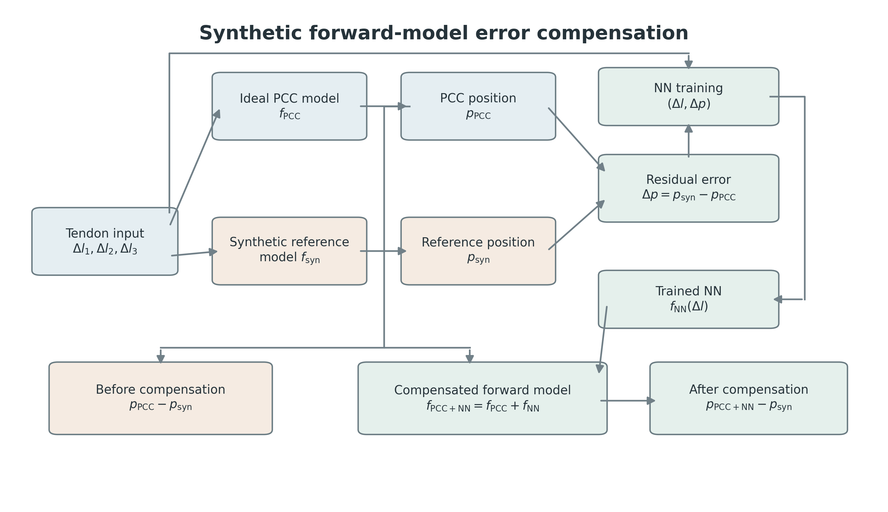
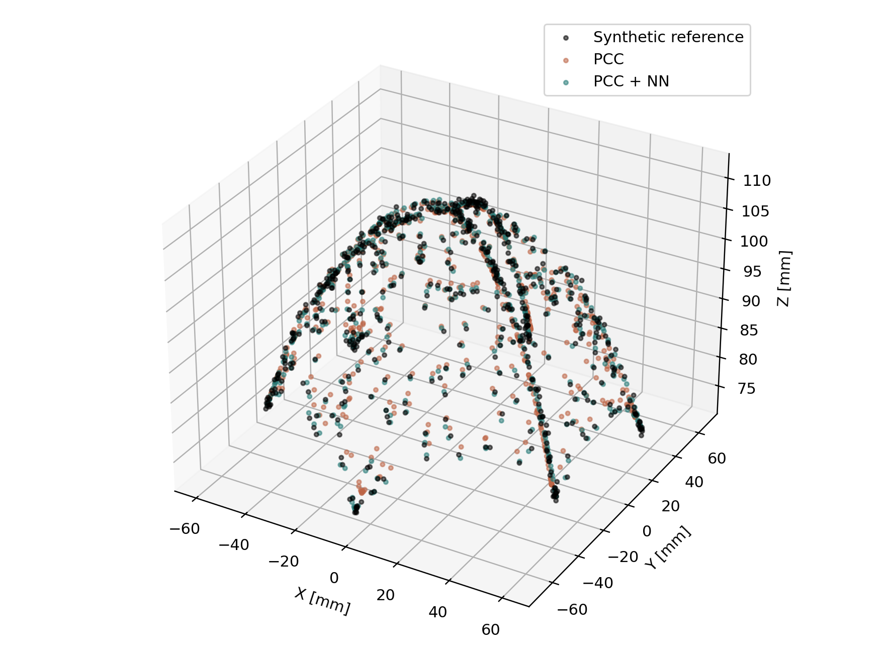
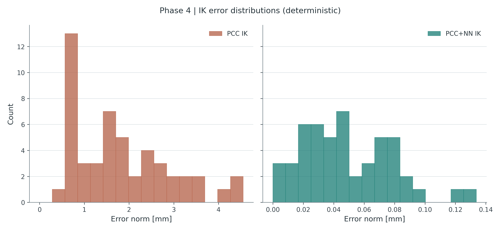
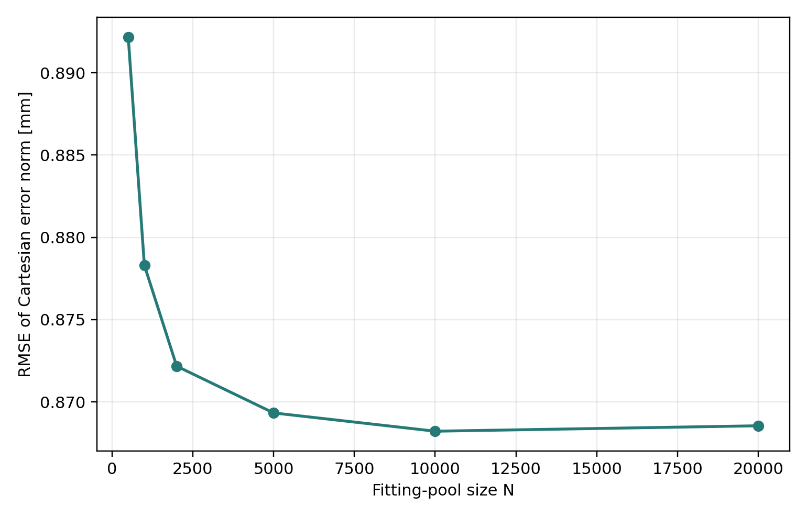
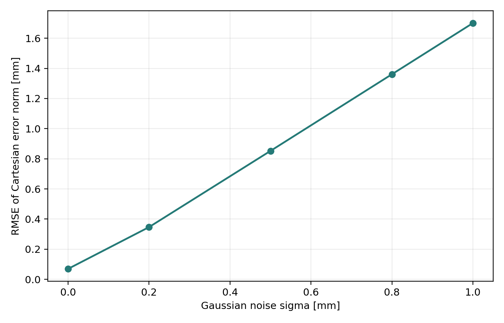
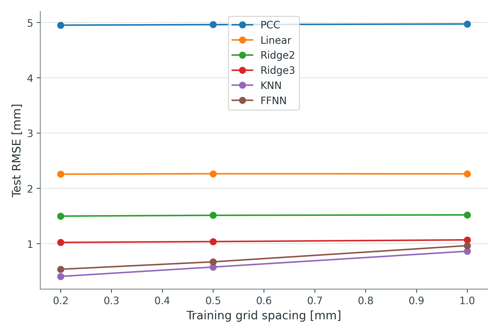
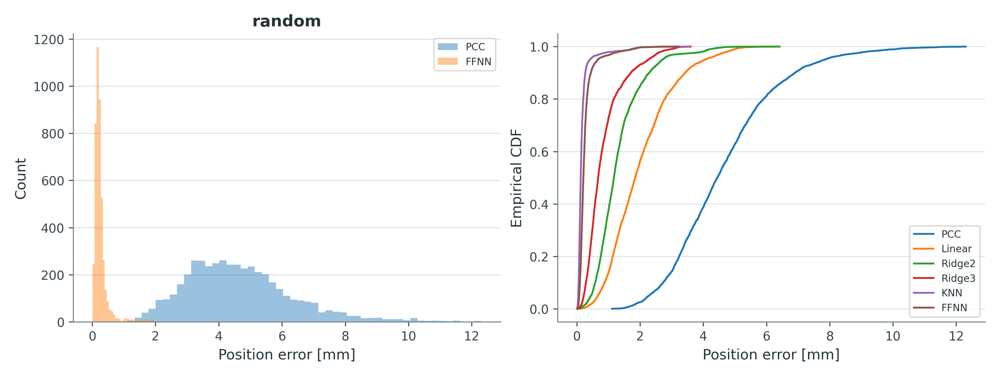
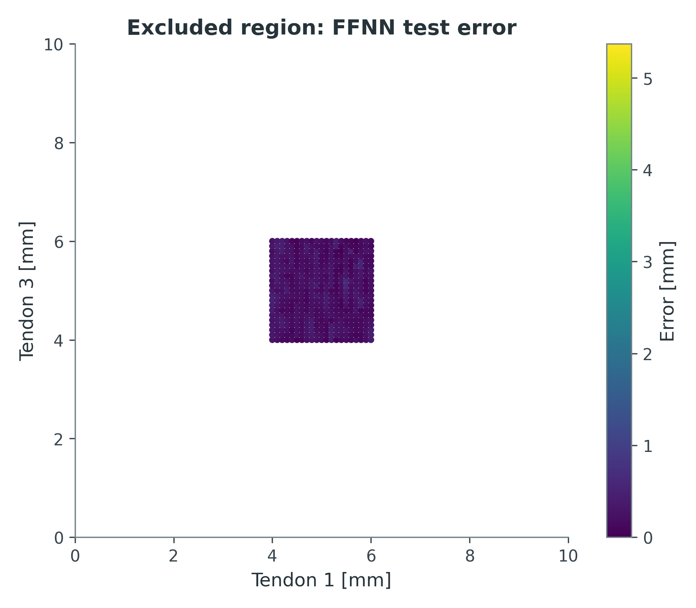

# Continuum Robot Kinematics · Error Compensation

**A research dashboard and reproducible study of analytical kinematics, residual learning, and physical endpoint measurements.**

This diploma project investigates whether data-driven residual models can improve the forward position predicted by a piecewise constant-curvature (PCC) model of a three-tendon continuum robot. The repository separates a synthetic reference study from experiments on measured physical endpoints. Its desktop dashboard lets you explore both without presenting simulated shapes as physical observations.

> **Measurement boundary:** Phase 6 contains measured **tip positions**, not measured robot backbones. Physical XYZ is provisionally treated as millimetres. PCC is aligned to measurements using training data; independent sensor-frame calibration has not been established.

## GUI showcase

The PySide6 / pyqtgraph workstation uses a warm neutral CAD-style interface around a charcoal 3D viewport. Its left rail opens Robot, Compensation, Measurements and a dedicated Analysis workspace. The central view shows an interactive analytical backbone and three live projections; the right inspector holds tendon controls, model context, display settings and test-point selection. Select an experiment to load its saved registration, scalers and model artifacts. Missing files are reported in the interface.

**Application screenshot:** pending a manual capture. Launch the application, use **Capture** or `Ctrl+Shift+S` for an application-only PNG, and save the actual image to [`figures/gui/`](figures/gui/README.md). The 3D viewport can also be exported separately. An image will be embedded here after a real capture has been inspected.

## Main features

- **Two distinct data modes:** deterministic synthetic reference and held-out physical endpoint measurements.
- **Interactive geometry:** analytical PCC tube, endpoint markers, error vectors, three Cartesian projections and constrained tendon controls.
- **Physical cloud inspection:** Off, sampled Light and Full modes; error colours; robot-focused and whole-workspace camera framing.
- **Saved-model analytics:** a dedicated Analysis workspace for per-experiment RMSE, error CDF, sparse-grid and excluded-region trends, and per-axis errors. The GUI reads saved Phase 6 v2 artifacts; it does not fit models.

| Explore | What is shown |
|---|---|
| **Synthetic demonstration** | PCC curve, synthetic model curve and endpoint, saved Phase 3 NN endpoint correction. The reference is deterministic simulation output. |
| **Physical measurements** | Registered PCC analytical curve, saved Phase 6 v2 endpoint predictors, and actual endpoint observations from the selected **test split**. No measured curve is drawn. |
| **Analysis workspace** | Saved test RMSE, error CDF, sparse-grid and held-out-region comparisons, and per-axis errors. No benchmark is run by the GUI. |

## Methodology

The learned models predict a Cartesian endpoint residual, which is added to the analytical position:

`p_corrected(Δl) = p_PCC(Δl) + f_ML(Δl)`



Phase 6 uses a different target: a physical measured endpoint. Every experimental split fits PCC-to-measurement registration on **training** positions, selects a registration and model settings on **validation** positions, and scores only on the untouched **test** positions. Details: [methodology](docs/methodology.md) · [physical protocol](docs/physical_validation.md).

## Research progression · six phases

### Phase 1 — PCC Forward Kinematics

**Objective and method.** Establish an analytical baseline for a one-segment, three-tendon continuum robot. The nominal backbone length is **110 mm**; the tendon-routing parameter in the equations is **5 mm**. Commands shorten tendons by up to **10 mm**, with at most two active at once. The piecewise constant-curvature (PCC) approximation converts tendon-length differences into curvature `κ`, bending-plane angle `φ`, and total bending angle `θ`. Integrating the circular arc and rotating it into the Cartesian frame yields a backbone centreline and tip position. A guarded straight-robot case avoids a numerical singularity at zero curvature.

**Implementation and result.** [`pcc_model.py`](src/continuum_robot/kinematics/pcc_model.py) exposes the bend parameters, sampled shape and forward tip prediction. Sweeping admissible commands produces the theoretical reachable workspace. The desktop viewport renders this **analytical** centreline; the displayed tube radius is illustrative. Phase 1 supplies the common geometric baseline and the forward map reused by residual learning and inverse kinematics. Its workspace is a model prediction, not a physical measurement. The full [methodology](docs/methodology.md) explains how later phases compare that prediction with distinct reference sources.

### Phase 2 — Synthetic Reference Model

**Objective and method.** Provide controlled target positions before using physical robot measurements. A deliberately perturbed PCC reference introduces curvature nonlinearity, bending-plane asymmetry, bend saturation, systematic Cartesian offsets and Gaussian endpoint noise. The generated tendon commands obey the same actuation limits as Phase 1. The residual is the reference tip minus the analytical PCC tip; it is the target later learned by regressors. Synthetic samples make error sources and model comparisons reproducible, but they cannot establish real-robot accuracy.

**Implementation and evidence.** The reference equations are in [`synthetic_reference.py`](src/continuum_robot/kinematics/synthetic_reference.py); the [dataset generator](src/continuum_robot/data/generate_dataset.py) creates command/position pairs. Saved dataset provenance, rather than present-day module defaults, defines the exact perturbation settings used in the canonical Phase 3 comparison: see the [Phase 3 summary](results/final/phase3_forward_compensation/summary.json). That evaluation uses **20,000** generated configurations, with train, validation and test subsets. This phase also establishes the classical regression comparison used in Phase 3. The diagram above shows the analytical prediction, synthetic target and residual relationship.

### Phase 3 — Neural Network Error Compensation

**Objective and method.** Learn a three-dimensional endpoint correction from tendon shortening. The PyTorch feedforward network receives the three shortenings and activity indicators, and predicts `ΔX`, `ΔY`, `ΔZ`; its output is added to PCC. The canonical **20,000-sample synthetic** dataset is divided into **14,000 training, 3,000 validation and 3,000 test** rows. Training-only fitted scalers and a held-out validation set support model development; the final test set compares PCC, Linear Regression, Polynomial Ridge, KNN and the saved NN. The [training implementation](src/continuum_robot/phase3/train_nn.py) and [evaluation](src/continuum_robot/phase3/evaluate_extended.py) retain those roles.

**Result.** On the 3,000 synthetic test positions, Euclidean RMSE is **2.227 mm** for PCC, **1.285 mm** for Linear Regression, **0.868 mm** for Polynomial Ridge, **0.955 mm** for KNN and **0.869 mm** for the NN. Ridge is marginally lower than NN here; the result does not support a claim that NN is always best. The [metrics](results/final/phase3_forward_compensation/phase3_metrics.csv), [loss curve](results/final/phase3_forward_compensation/loss_curve.png) and [position comparison](results/final/phase3_forward_compensation/reference_pcc_nn_3d.png) document the experiment. The remaining error is close to the saved synthetic noise floor, so these numbers describe that simulated reference only.



*Synthetic forward positions: analytical baseline and learned endpoint correction.*

### Phase 4 — Compensated Inverse Kinematics

**Objective and method.** Test whether the learned **forward** correction also helps choose tendon commands for a target position. Numerical optimization solves inverse kinematics (IK) using either PCC or PCC plus the saved Phase 3 NN as its forward map. Commands remain in **0–10 mm**, with no more than two active tendons. The synthetic reference supplies targets and evaluates the reached endpoint; it is not used inside the IK optimizer. The error is the Euclidean distance from reached to target position. The [IK implementation](src/continuum_robot/phase4/inverse_kinematics.py) and [evaluation](src/continuum_robot/phase4/evaluate_extended.py) define the procedure.

**Experiments and result.** The deterministic study has **50 synthetic targets**, including **15 boundary or large-bend cases**. PCC IK and PCC+NN IK give **2.107 mm** and **0.057 mm** RMSE respectively. With **0.5 mm Gaussian noise** in the separate noisy study, they give **2.297 mm** and **0.962 mm**. The [deterministic metrics](results/final/phase4_ik_validation/phase4_ik_metrics.csv), [noisy metrics](results/final/phase4_ik_validation_noise05/phase4_ik_metrics.csv) and [error plot](results/final/phase4_ik_validation/ik_error_histogram.png) show the full distributions. These are simulated IK tests; physical inverse-kinematics accuracy has not been established.



*Deterministic synthetic IK errors for the two forward maps.*

### Phase 5 — Additional Synthetic Experiments

**Objective.** Probe which conclusions depend on dataset size, observation noise, actuation range or NN capacity. All four studies use the **synthetic** reference and separate held-out samples; their outputs are in the [summer experiment directory](results/final/summer_experiments/). The [experiment runner](src/continuum_robot/experiments/summer_synthetic_experiments.py) and [summary](results/final/summer_experiments/summary.json) record settings and provenance.

1. **Dataset size.** Retrained networks use fitting pools from **500 to 20,000** samples and a shared 2,000-point test set. At 0.5 mm noise, RMSE decreases from **0.892** to approximately **0.869 mm**, with little gain beyond 5,000–10,000 samples ([table](results/final/summer_experiments/dataset_size_metrics.csv)).
2. **Gaussian noise.** The saved canonical NN is **evaluated without retraining** as synthetic test noise rises from σ=0 to 1.0 mm. RMSE rises from **0.069** to **1.701 mm** ([table](results/final/summer_experiments/noise_metrics.csv)); this is sensitivity to test noise, not a noise-robustness training comparison.
3. **Out-of-range generalization.** Training covers **0–8 mm** and test commands extend into **(8, 10] mm**. NN RMSE rises from **0.008** inside to **0.259 mm** outside the training range ([table](results/final/summer_experiments/generalization_metrics.csv)).
4. **Architecture.** On a common 5,000-sample fitting pool, `[32,32]`, `[128,64]` and `[256,128,64]` networks give **0.871**, **0.869** and **0.871 mm** RMSE ([table](results/final/summer_experiments/architecture_metrics.csv)). Extra capacity brings no clear gain in this setting.

 

*Phase 5: training-set size and test-noise sensitivity. The [range](results/final/summer_experiments/generalization_boxplot.png) and [architecture](results/final/summer_experiments/architecture_boxplot.png) figures complete the four studies.*

### Phase 6 — Physical Robot Experimental Validation

**Objective and dataset.** Replace the synthetic target with measured Cartesian **tip positions**. The raw dataset records **30,250 configurations**, with tendon commands `l1,l2,l3` in **0–100** converted to physical shortening by `Δlᵢ = lᵢ / 10 mm`. The three output columns are measured endpoint `X,Y,Z`. The [physical protocol](docs/physical_validation.md) documents source preservation, quality checks, outliers and dataset coverage; most configurations lie on two-tendon actuation planes. There are no measured backbone curves or repeated dynamic trajectories.

**Method and implementation.** PCC predictions and measured XYZ need a common frame. Each experiment fits an **empirical PCC-to-measurement registration using training data only**; validation selects registration and model settings, and untouched test rows are scored once. Input and residual scalers also fit on training data. Linear Regression, degree-2 and degree-3 Polynomial Ridge, KNN and FFNN predict the measured endpoint residual relative to registered PCC. The [reviewed v2 runner](src/continuum_robot/phase5/review_v2.py), saved [registration files](results/final/phase6_review_v2/), [model artifacts](artifacts/phase6_review_v2/) and [provenance](docs/reproducibility.md) specify the pipeline. The physical GUI loads the selected split's own registration and models; it never invents a measured robot shape.

**Seven protocols and result.** A random split tests interpolation; three sparse training grids (**0.2, 0.5, 1.0 mm**) test reduced command coverage; and three excluded actuation-plane regions test extrapolation into held-out workspace. The table below reports Euclidean test RMSE in millimetres from saved [v2 metrics](results/final/phase6_review_v2/all_metrics.csv). KNN leads random and sparse-grid tests, while FFNN leads all three region holdouts. On the random test's **4,538** measured endpoints, registered PCC is **4.970 mm**, KNN **0.320 mm** and FFNN **0.389 mm**. A paired [v1–v2 comparison](results/final/phase6_review_v2/paired_legacy_comparison.csv) uses common test IDs and shows that v2 is **not universally better** than v1. The [research answers](results/final/phase6_review_v2/research_answers.md) discuss RQ1–RQ5.

**Scientific boundary.** The registration is an empirical, training-based alignment; an independent sensor-frame calibration has **not** been established. Physical XYZ is provisionally treated as millimetres. These tests evaluate static forward endpoints, not physical inverse kinematics. Their numerical differences on one dataset do not, by themselves, establish statistical significance. The strongest conclusion is protocol-specific reduction of held-out endpoint error under the stated registration and data coverage.



*Phase 6: physical endpoint error as command-grid spacing increases.*

## Key results

All errors below are Euclidean test-position RMSE in **mm**. Synthetic and physical experiments use different targets and must not be compared as the same benchmark.

| Setting | Analytical baseline | Learned correction | RMSE [mm] |
|---|---:|---|---:|
| Phase 3 synthetic forward, 3,000 held-out points | PCC **2.227** | Polynomial Ridge / NN | **0.868 / 0.869** |
| Phase 4 synthetic deterministic IK, 50 targets | PCC IK **2.107** | PCC+NN IK | **0.057** |
| Phase 6 v2 physical random test, 4,538 endpoints | Train-registered PCC **4.970** | KNN / FFNN | **0.320 / 0.389** |

The Phase 6 v2 physical results show different strengths across evaluation protocols:

| Physical test | Registered PCC | KNN | FFNN | Lower RMSE |
|---|---:|---:|---:|---|
| Random interpolation | 4.970 | **0.320** | 0.389 | KNN |
| Sparse grid · 0.2 mm | 4.950 | **0.407** | 0.537 | KNN |
| Sparse grid · 0.5 mm | 4.960 | **0.577** | 0.671 | KNN |
| Sparse grid · 1.0 mm | 4.972 | **0.863** | 0.964 | KNN |
| Excluded region · plane 1 | 3.016 | 0.684 | **0.228** | FFNN |
| Excluded region · plane 2 | 4.234 | 0.656 | **0.251** | FFNN |
| Excluded region · plane 3 | 3.221 | 0.622 | **0.323** | FFNN |

Values are rounded from [v2 metrics](results/final/phase6_review_v2/all_metrics.csv). The [paired v1–v2 comparison](results/final/phase6_review_v2/paired_legacy_comparison.csv) uses identical test IDs and shows that v2 does **not** universally outperform historical v1. Full MAE, median, P95, maximum and axiswise errors remain in the CSV files. [Research answers](results/final/phase6_review_v2/research_answers.md) discuss RQ1–RQ5.

## Selected figures

| Physical random-test error distribution | Physical excluded-region evaluation |
|---|---|
|  |  |

*The left figure compares endpoint-error distributions on a common physical test split; the right isolates an excluded region. Both come from saved Phase 6 v2 evaluations.*

More figures: [synthetic validation](docs/synthetic_validation.md) · [physical validation](docs/physical_validation.md).

## Install and run

From the repository root in PowerShell:

```powershell
py -3.11 -m venv .venv
.\.venv\Scripts\python.exe -m pip install -r requirements.txt
.\.venv\Scripts\python.exe -m pip install -e . --no-deps
.\.venv\Scripts\python.exe -m continuum_robot.gui.pcc_gui
```

If an existing `.venv` already has the dependencies and editable install, use only the final command. The GUI requires a working OpenGL driver and `PyOpenGL`; it does not start training or experiment scripts. Drag to rotate, use the wheel to zoom and middle drag to pan; `R` selects the straight configuration, `F` focuses the robot, and `Ctrl+Shift+S` captures an actual dashboard PNG. Use **Fit workspace** to frame the complete physical test cloud. [Dashboard and screenshot guide](docs/reproducibility.md#dashboard-workflow).

## Reproducing experiments

The saved results are ready for inspection. To check the physical source and split lineage **without retraining**:

```powershell
.\.venv\Scripts\python.exe -m continuum_robot.phase5.review_v2 check
```

Training a fresh v2 run is a separate, explicitly invoked operation. Its command, output paths and comparison procedure are in [reproducibility](docs/reproducibility.md). Historical synthetic commands and detailed provenance remain in the [archived technical README](docs/legacy_readme.md).

## Repository map

```text
src/continuum_robot/  PCC, synthetic reference, residual models, IK, GUI
data/real/            Immutable physical source and documented preprocessing
artifacts/            Saved scalers and model weights
results/final/        Synthetic studies, historical physical v1, reviewed v2
figures/              Methodology figures and manually captured GUI screenshots
docs/                 Scientific method, validation and reproduction notes
```

## Limits and documentation

The physical dataset has 30,250 unique endpoint observations, mostly from two-tendon actuation planes. It does not provide observed backbone shapes, repeated trials, motion history, a confirmed measurement frame or three-active-tendon coverage. The empirical registration may absorb some PCC geometry error. Numeric differences between models on one static dataset do not alone establish statistical significance, and Phase 6 does not validate physical inverse kinematics.

- [Methodology and display semantics](docs/methodology.md)
- [Synthetic validation and provenance](docs/synthetic_validation.md)
- [Physical validation and coordinate assumptions](docs/physical_validation.md)
- [Install, dashboard use and intentional reruns](docs/reproducibility.md)
- [Archived detailed README](docs/legacy_readme.md)
