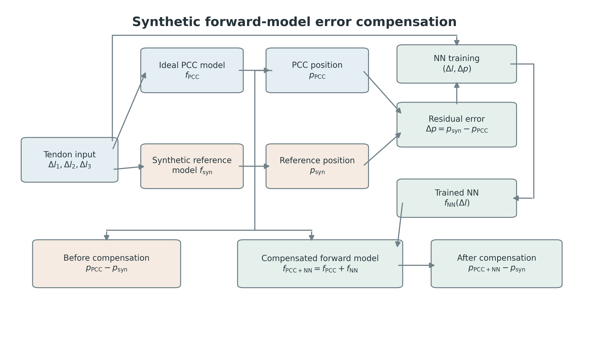

# Model and visualization methodology

The robot model has one nominal 110 mm segment and three tendons. The existing PCC equations in [`pcc_model.py`](../src/continuum_robot/kinematics/pcc_model.py) map tendon shortening `Δl ∈ [0,10]^3 mm`, with at most two active tendons, to a centreline and tip position. The GUI uses this same function; no kinematic equations were changed for the dashboard.

The residual models predict Cartesian **endpoint error**, not an entire physical backbone:

`p_corrected(Δl) = p_PCC(Δl) + f_ML(Δl)`

For synthetic studies, the target is the explicitly synthetic reference model. The GUI displays its deterministic expected endpoint, including the reference model's fixed endpoint offset, while disabling fresh random noise draws during slider movement. Its displayed synthetic curve is the unshifted shape supplied by `real_shape`; the separate reference endpoint marker includes the modelled tip offset. Neither item represents a physical observation.

For physical studies, the endpoint observations come from the experimental dataset. Phase 6 v2 fits a coordinate registration on training observations and selects among candidates on validation observations. All model comparisons then use the same saved test rows. The GUI transforms the analytical PCC centreline into this **assumed measurement frame** for visual context and shows corrected predictions as endpoints only. It never renders a measured physical backbone, because only endpoint positions were measured.

The dashboard is read-only with respect to model artifacts and experiment results. Its 3D tube radius is a visual convention and is not measured robot geometry. The model and protocol definitions remain in the experiment scripts, not in GUI code.

For the complete historical implementation detail, see the [archived technical README](legacy_readme.md). For current physical assumptions and data lineage, see [physical validation](physical_validation.md).
