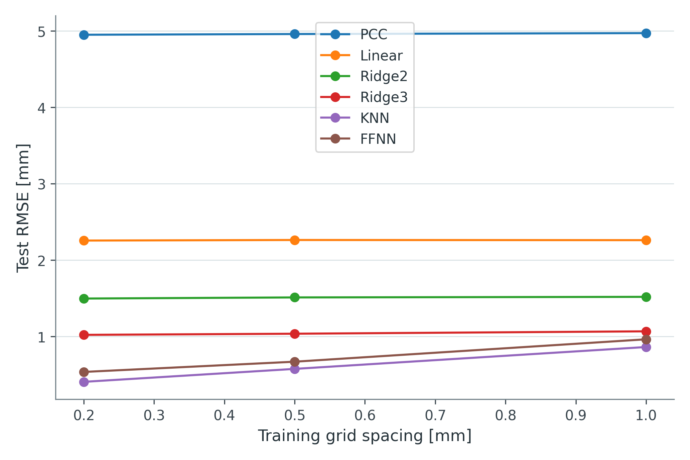
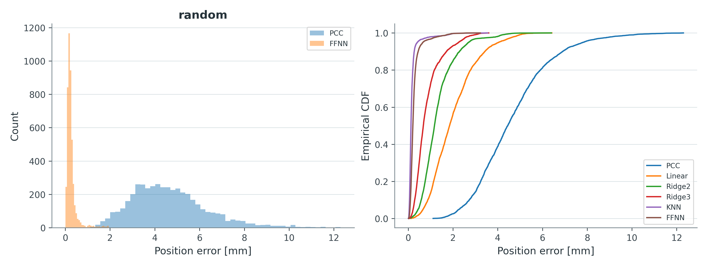

# Phase 6 physical validation

## Data and coordinates

The unmodified physical source is [`Dataset-Actions-Positions.txt`](../data/real/Dataset-Actions-Positions.txt), SHA-256 `baffabb280744621d820f95beb2e7ad1c05f7b795bed7da3d16993a811d284c3`. It contains 30,250 unique actuator configurations. Commands 0–100 represent 0–10 mm tendon shortening (`Δl_i = l_i / 10 mm`). The dataset includes endpoint XYZ only, no physical backbone shapes or repeated trajectories. Cartesian XYZ units are provisionally treated as millimetres.

The measurement-frame origin, axes, tracked marker geometry and physical cable numbering have not been independently confirmed. The nominal PCC straight tip is `(0,0,110)` mm, while the nearest measured commands lie near `(-43,-144,277)` in source coordinates. Directly subtracting these coordinate frames would be invalid.

For each split, the [v2 protocol](../src/continuum_robot/phase5/review_v2.py) fits candidate translations or rigid orthogonal transforms on training XYZ only and selects the candidate on validation XYZ. Scale is fixed at one. The resulting baseline is **train-registered PCC**, not an independently calibrated physical PCC model. Cable permutations under a free orthogonal transform do not identify physical cable labels. Exact transforms, candidate scores and IDs are saved with each experiment.

## Evaluation protocol

- Random 70/15/15 interpolation split, seed 42.
- Sparse actuator training grids with spacing 0.2, 0.5 and 1.0 mm; off-grid observations are the test sets.
- Three 4–6 mm contiguous held-out squares, one in each two-tendon plane.
- Common saved test IDs for PCC, Linear, Polynomial Ridge degrees 2 and 3, KNN and FFNN.
- Input and residual scalers fit on train only. Registration and hyperparameters use train/validation only; test XYZ does not influence either.
- All valid physical test rows remain in the primary metrics. The 267 QA flags are descriptive and are not used to select v2 training rows.

## V2 held-out RMSE

| Test protocol | N | Registered PCC | KNN | FFNN | Best of KNN / FFNN |
|---|---:|---:|---:|---:|---|
| Random interpolation | 4,538 | 4.970 | **0.320** | 0.389 | KNN |
| Sparse 0.2 mm | 22,625 | 4.950 | **0.407** | 0.537 | KNN |
| Sparse 0.5 mm | 29,000 | 4.960 | **0.577** | 0.671 | KNN |
| Sparse 1.0 mm | 29,925 | 4.972 | **0.863** | 0.964 | KNN |
| Region 1 | 441 | 3.016 | 0.684 | **0.228** | FFNN |
| Region 2 | 441 | 4.234 | 0.656 | **0.251** | FFNN |
| Region 3 | 441 | 3.221 | 0.622 | **0.323** | FFNN |

The table is rounded from [the completed v2 metrics](../results/final/phase6_review_v2/all_metrics.csv). [Research answers](../results/final/phase6_review_v2/research_answers.md) include all compared methods and limitations. [Paired v1–v2 comparison](../results/final/phase6_review_v2/paired_legacy_comparison.csv) uses identical test row IDs: the v2 FFNN is slightly better on random interpolation and region 2, essentially unchanged on sparse 0.2/1.0 mm, and worse on sparse 0.5 mm and regions 1/3. V2 therefore does **not** uniformly improve v1.

## What the results establish

The saved physical-data tests show that residual models substantially reduce error relative to the empirically registered PCC baseline on the evaluated configurations. KNN is strongest on dense random and sparse-grid interpolation tests; FFNN is strongest in the three excluded-region tests. A dense grid makes KNN's local interpolation especially favorable. These observations do not show performance outside the measured actuator domain or under repeated physical trials.

There is no independent sensor-to-PCC calibration, confirmed XYZ unit, measured backbone, three-active-tendon evaluation, time/hysteresis study, or physical IK validation. One fixed seed and a spatially correlated grid cannot establish statistical significance from numeric differences alone. The archived v1 `clean_train` sensitivity used global neighbourhood QA flags and is not treated as a strict leakage-free data-cleaning claim. The GUI displays v2 **test endpoints** and model predictions; it does not change the scientific protocol.
