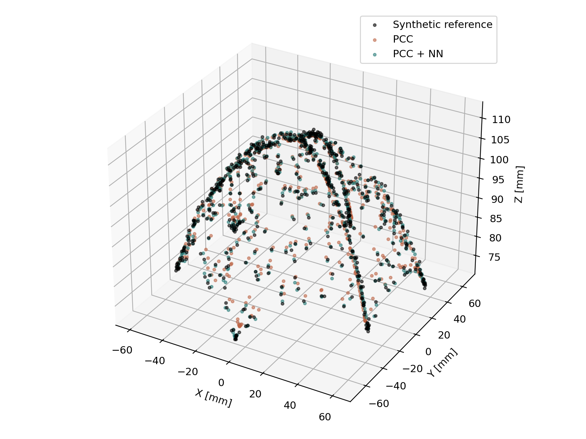
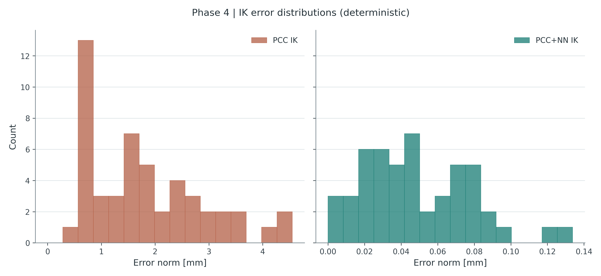

# Synthetic validation · Phases 2–5

The synthetic reference is a deliberately perturbed PCC model. It is not a measured robot. Phase 3 learns `p_synthetic − p_PCC`; Phase 4 uses the trained correction inside forward evaluations of an inverse-kinematics solver, while the synthetic reference supplies targets and final assessment only. Phase 5 examines dataset size, noise, range and network architecture.

## Representative results

| Study | Comparison | Held-out RMSE [mm] |
|---|---|---:|
| Phase 3 forward, 3,000 synthetic test samples | PCC / Polynomial Ridge / NN | 2.227 / 0.868 / 0.869 |
| Phase 4 deterministic IK, 50 synthetic targets | PCC IK / PCC+NN IK | 2.107 / 0.057 |
| Phase 4 noisy IK, 50 synthetic targets | PCC IK / PCC+NN IK | 2.297 / 0.962 |

Values are rounded from [Phase 3 metrics](../results/final/phase3_forward_compensation/phase3_metrics.csv), [deterministic Phase 4 metrics](../results/final/phase4_ik_validation/phase4_ik_metrics.csv), and [noisy Phase 4 metrics](../results/final/phase4_ik_validation_noise05/phase4_ik_metrics.csv). The studies have different targets and error definitions; these rows should not be interpreted as one common benchmark.

The [summer experiment tables](../results/final/summer_experiments/) include the full dataset-size, noise, range and architecture studies. Their synthetic conclusions do not establish physical robot accuracy. Earlier provenance and detailed commands are retained in the [archived technical README](legacy_readme.md).
